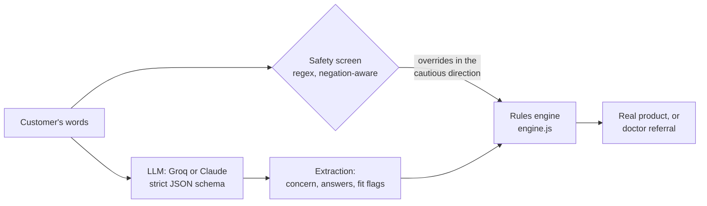

# Day 90

**A 90-day companion for Be Bodywise customers: find the right product, check it fits your cause, track real progress, and get honest answers when you're about to give up.**

Built for the Mosaic Wellness Fellowship Builder Challenge (Be Bodywise).

## The problem

Customer reviews of the Be Bodywise Hair Growth Roll-On and Underarm Roll-On showed the same product getting opposite verdicts. The difference was not the product. It was **who used it and how long they lasted**:

- The pack promises visible results in **3 months**. People who called it "a waste of money" stopped at about **2 months**. The person it worked for said it "takes 2–3 months" and "you have to be consistent".
- Some people bought a product that **could not fit their cause**: hormonal thinning, a medical condition, sensitive skin that burned.
- Nobody had a **baseline**. Slow progress looks identical to no progress in a mirror, so people judged by eye, quit around weeks 6–8, posted a negative review and switched brands.

**Problem statement:** customers quit before the product's own result window because they can't see gradual progress, have nothing to compare against, and were never checked for fit. Slow progress feels like failure.

## What Day 90 does

| Feature | What it solves |
|---|---|
| **Describe it in your own words** (AI) | Customers explain their concern in English, Hindi or Hinglish. Claude extracts the answers; the rules engine picks the product. |
| **Product finder** | Real Be Bodywise products by concern and skin type, each with key actives, how to use it, and what real reviewers liked and disliked. |
| **Fit check** | Catches causes a cosmetic product won't fix (PCOS or thyroid hair loss, round bald patches, velvety skin, severe acne) and refers to a doctor instead of wasting 3 months. |
| **Day-0 baseline** | Guided photo (same angle and light) plus one simple score. |
| **13-week track and timeline** | Shows what's normal each week, and marks the drop-off zone. |
| **Drop-off zone warning** | At weeks 6–8 it shows the customer their own numbers and the date of day 90. |
| **Weekly 30-second check-in** | Photo, two taps, missed days, a note. A stinging or burning answer triggers a stop-and-patch-test warning. |
| **Ask Day 90** (AI) | Answers "is it working?", missed days, how to use it, minoxidil, pregnancy, orders. Uses the customer's own numbers; red flags go to a doctor; order questions go to support. |
| **Week-12 verdict** | "It's working, reorder" or "see a dermatologist before switching brands". |

## How the AI is used

**Rules decide what is safe; the model handles what people actually say.**



- **Intake** (`lib/intake.js`): the model only *extracts* into a strict schema (enums for every field). It never names products. The rules engine (`public/engine.js`) chooses from the real catalog, so a suggestion can never be a product Bodywise doesn't sell.
- **Ask Day 90** (`lib/coach.js`): messages with red flags (burning, rash, bald patch, cystic acne) get a fixed, reviewed answer **without calling the model**. Everything else goes to the model with a context built from the customer's own check-ins, the phase timeline and product facts. Replies are checked by guardrails (no other brands or prescription drugs, no "cure"/"guarantee", no invented phone numbers or emails, length cap). A failing reply is replaced by phase guidance.
- **Privacy**: photos and notes never leave the device. Only week numbers and scores are sent to the assistant. No login, no database.
- **Models (pick one with `LLM_PROVIDER`)**:
  - `groq`: `openai/gpt-oss-120b` on Groq with strict JSON-schema decoding, plus retry on rate limits. Free tier, very fast. Override with `GROQ_MODEL`.
  - `anthropic`: `claude-opus-5-5` with structured outputs, low effort, and the server-side refusal fallback. Override with `CLAUDE_MODEL`.

  Both sit behind one function (`lib/llm.js`), so the rules, guardrails and evaluation are identical for either. The eval can compare them directly.

## Evaluation

`eval/` holds hand-labelled cases and deterministic graders that call the app's real entry points.

- **Intake: 30 cases.** English, Hindi and Hinglish; red flags; negations ("no bald patches"); missing answers; off-scope requests (face acne, headaches); multi-concern messages.
- **Ask Day 90: 18 cases.** These run across five journeys: hair at week 3, hair at week 7 and improving, hair at week 12 with no change, underarm at week 2, and underarm at week 5.

Metrics:

| Suite | Metrics |
|---|---|
| Intake | Concern accuracy, field accuracy, fit-flag recall, **doctor-referral recall**, unneeded referrals, top-product accuracy, follow-up when information is missing |
| Ask Day 90 | Intent, **doctor and support escalation**, grounding in the user's own numbers, guardrail pass rate, rules-path correctness, plus cost and median latency from API usage |

Harness checks (so the scores mean something):

| Run | Intake | Ask Day 90 |
|---|---|---|
| Oracle (gold answers through the graders) | 30/30 | 18/18 |
| Null baseline (constant answer) | 6/30 | 0/18 |

The first oracle run found three real bugs in the rules layer:
1. "No bald patches" was sent to a doctor.
2. Severe acne waited for a skin-type answer before referring.
3. Body acne with sensitive skin crashed the intake.

All three were fixed in `aadbbaf`.

Live results: see [`eval/RESULTS.md`](eval/RESULTS.md).

```bash
npm run eval:check                 # validate graders (no API key needed)
npm run eval                       # live run against the configured provider
npm run eval -- --suite coach --reps 3
```

## Run locally

Needs Node 20 or later.

```bash
npm install
cp .env.example .env               # then add your GROQ_API_KEY (or ANTHROPIC_API_KEY)
npm run dev                        # http://localhost:3000
npm test                           # 32 unit tests, no API key needed
```

Without a key the app still works: the finder questions, tracking and the rule-based safety answers all run; the two AI features show a friendly "not set up" message.

## Deploy (Vercel)

1. Import the GitHub repo at [vercel.com/new](https://vercel.com/new). The framework preset is "Other" and no build step is needed.
2. In **Settings → Environment Variables**, add `LLM_PROVIDER` = `groq` and `GROQ_API_KEY` (or `ANTHROPIC_API_KEY` for Claude).
3. Deploy. Static files are served from `public/`, and `api/intake.js` and `api/coach.js` become serverless functions.

## Project layout

```
public/      index.html, app.js (UI), engine.js (rules + data, shared), styles.css
api/         intake.js, coach.js: Vercel functions
lib/         llm.js (provider switch), groq.js, claude.js, intake.js, coach.js, http.js (guards, rate limit)
test/        node:test unit tests (rules, intake, coach with a mocked client)
eval/        cases/*.jsonl, graders.js, run.js
scripts/     dev.js: local server that mimics Vercel
```

## Research and sources

- **Research:** 10 public Reddit reviews and comments (r/IndianSkincareAddicts, r/IndianBeautyTalks), with direct customer conversations to follow. Review notes in the app are paraphrased, with no usernames.
- **Product data:** taken from bebodywise.com product pages in November 2026.
- **Disclaimer:** this is an independent concept, not affiliated with Mosaic Wellness. It gives general information, not medical advice.

## Built with

- **Building, research analysis and evaluation design:** Claude Code (Claude Opus 5.5)
- **Inside the app:** Groq (`openai/gpt-oss-120b`) or the Claude API (`claude-opus-5-5`), both with strict structured outputs
